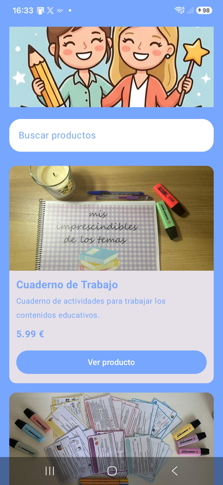
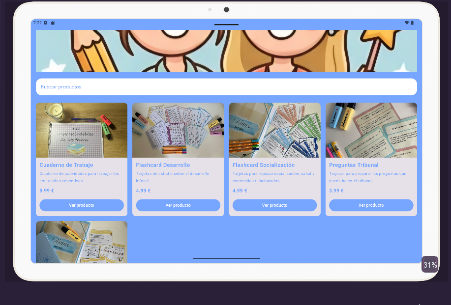

# Reto 2 · E-Commerce Adaptativo (OpoApp - Responsive UI)

**Módulo:** 0489 · Programación Multimedia y Dispositivos Móviles  
**Autor:** [David Fraile García]  
**Tecnología:** Kotlin + Jetpack Compose (Android nativo)  
**RA vinculado:** RA1 y RA2 · Interfaces adaptables y limitaciones del dispositivo  

## 📱 Producto Final (Capturas)

| Móvil (Vertical) | Tablet / Horizontal |
| :---: | :---: |
|  |  |

### Esquema de referencia
Así debería comportarse tu cuadrícula: mismas tarjetas, mismo código, más columnas cuando hay más espacio.

## 🎯 Objetivo del reto
Comprender la fragmentación de pantallas en Android y resolver los problemas de visualización en distintos perfiles de dispositivos. Pasar de un diseño estático a una interfaz *responsive* utilizando componentes de Jetpack Compose en la aplicación **OpoApp** (tienda de materiales y recursos para oposiciones), adaptando la cuadrícula en tiempo real según el espacio disponible.

## 🛠️ Componentes y conceptos utilizados

| Componente / Concepto | Para qué se usa en esta app |
| :--- | :--- |
| **LazyVerticalGrid** | Sustituye a `LazyColumn` para distribuir dinámicamente los productos en una cuadrícula desplazable. |
| **GridCells.Adaptive** | Calcula automáticamente cuántas columnas caben fijando un ancho mínimo de `250.dp` por tarjeta. |
| **Card** | Contenedor elevado que agrupa la imagen, el título, la descripción, el precio y el botón de compra de cada recurso. |
| **ContentScale.Crop** | Asegura que la imagen del producto (`180.dp`) y el banner (`150.dp`) llenen su espacio sin deformarse al rotar la pantalla. |
| **OutlinedTextField & State** | Implementa una barra de búsqueda que filtra en tiempo real la lista mediante `contains(busqueda, ignoreCase = true)`. |
| **LaunchedEffect & Coroutines** | Maneja la pantalla de bienvenida/portada ("📚 OpoApp") utilizando un retardo (`delay(1000)`) antes de mostrar el catálogo. |
| **Intents (`ACTION_VIEW`)** | Permite abrir enlaces externos en el navegador (sitio Eduki de cada producto y la web promocional del banner). |
| **Mock Data (`data class`)** | Uso de la clase `Producto` y la lista `catalogoRecursos` para simular el catálogo de materiales educativos. |

## 🧐 Reflexión y Pensamiento Crítico

1. **Sobre la adaptabilidad:** ¿Por qué hemos usado `GridCells.Adaptive(minSize = 250.dp)` en lugar de fijar el número de columnas con `GridCells.Fixed(2)`? ¿Qué ventaja tiene en el mundo real?
   > Usar `GridCells.Adaptive(minSize = 250.dp)` permite que Jetpack Compose calcule automáticamente cuántas columnas caben según el ancho disponible de la pantalla. En un móvil portrait se mostrarán 1 o 2 columnas, mientras que en una tablet o en orientación horizontal cabrán 3 o más. En el mundo real, dada la gran diversidad de dispositivos Android (teléfonos, tablets, plegables, Chromebooks), fijar el número de columnas con `GridCells.Fixed(2)` provocaría tarjetas demasiado estiradas en pantallas anchas o comprimidas en pantallas estrechas.

2. **Sobre el diseño UI:** ¿Qué ocurría con las tarjetas si el nombre de un producto era muy largo y ocupaba dos líneas mientras los demás ocupaban una? ¿Cómo lo hemos solucionado?
   > Si el nombre de un producto ocupa más líneas de lo esperado, las tarjetas pueden desalinearse. Se ha solucionado limitando líneas con parámetros como `maxLines = 1` y `singleLine = true` en campos de texto.

3. **Sobre las imágenes:** ¿Por qué es importante usar `ContentScale.Crop` en la imagen del producto cuando cambiamos el ancho de la tarjeta al rotar la pantalla?
   >`ContentScale.Crop` escala la imagen manteniendo la proporción original y recorta los bordes sobrantes para rellenar exactamente la altura fijada.

4. **Visión de futuro:** Ahora mismo nuestros productos están escritos directamente en el código (*hardcodeados*). ¿Qué crees que necesitaría nuestra app en el futuro para que esta tienda mostrara productos reales de internet?
   > Para conectar la aplicación a un catálogo real en la nube se necesitaría:
   > Servicio Web / API REST: Un backend que devuelva la información de los productos en formato JSON.
   > - **Cliente de Red (Retrofit o Ktor):** Una librería para realizar las peticiones HTTP asíncronas.
   > - **Carga asíncrona de imágenes (Coil):** Reemplazar los recursos locales (`R.drawable.*`) por URLs remotas descargadas dinámicamente.
   > - **Arquitectura MVVM & Repository:** Desvincular la lógica de datos de la interfaz usando un `ViewModel` y flujos de datos (`StateFlow`) para controlar estados de carga, éxito y error.

## 🚀 Cómo ejecutar el proyecto
1. Clonar el repositorio y abrir en **Android Studio**.
2. Sincronizar las dependencias con Gradle (**Sync Project with Gradle Files**).
3. Ejecutar (▶) primero en un emulador de móvil en vertical (ej. Pixel 6).
4. Girar la pantalla del emulador a horizontal (`Ctrl + Left` / `Cmd + Left`) o ejecutar en un emulador de Tablet para comprobar la adaptación automática de la cuadrícula.

## 🐞 Dificultades y cómo las resolví
- **Superposición con las barras del sistema:** Al activar `enableEdgeToEdge()`, la interfaz se solapaba con la barra superior. Se solucionó añadiendo el modificador `.statusBarsPadding()` en el contenedor principal.
- **Filtrado dinámico sin perder estado:** Para lograr que la cuadrícula se actualizase al escribir en el buscador sin reiniciar el estado de la interfaz, se utilizó `remember { mutableStateOf("") }` junto con el operador `filter` de Kotlin.
